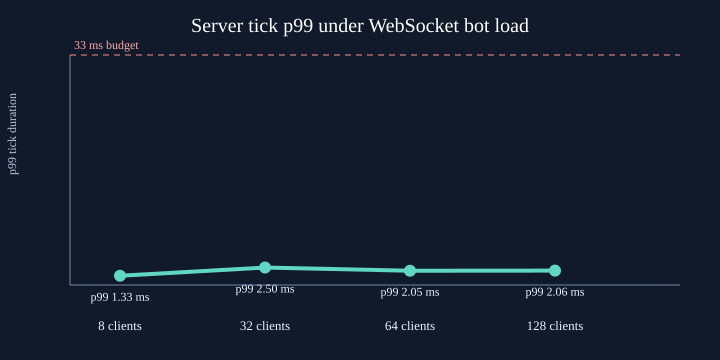
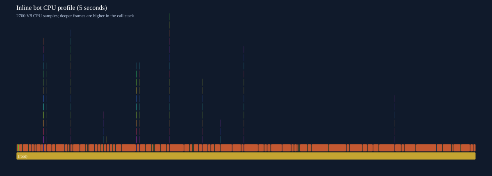
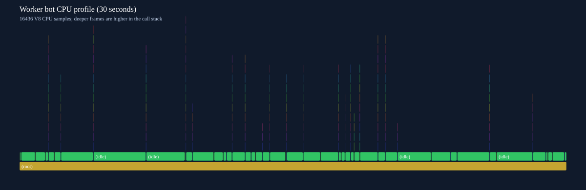

# Lab 04 — Node.js, EventEmitter, streams і WebSocket

Star Runner з лабораторних 1–3 тепер працює через Node.js сервер. Сервер роздає зібраний клієнт, керує кімнатами та чатом через WebSocket і записує події матчу потоками NDJSON. Координати та симуляція кораблів мережею не передаються — це залишається для лабораторної 5.

## Запуск

Потрібні Node.js 22 або новіший і npm.

```bash
npm install
npm run build
npm start
```

Відкрийте `http://localhost:3000`. Перевірка стану сервера: `http://localhost:3000/health`.

Для розробки запустіть обидва процеси:

```bash
npm run dev
```

Команда запускає Node сервер і Vite. Відкрийте адресу Vite, яку покаже термінал (зазвичай `http://localhost:5173`). Vite проксує `/api`, `/health` і WebSocket `/ws` на сервер.

PowerShell: якщо політика блокує `npm`, виконуйте команди через `npm.cmd`.

## Структура

```text
client/                 # клієнт Lab 1–3, Vite, Canvas та UI
  public/
  src/
server/
  config.js             # перевірка конфігурації оточення
  http-server.js        # API та безпечна роздача dist/
  index.js              # запуск і graceful shutdown
  match-logger.js       # pipeline подій у NDJSON
  room.js               # EventEmitter кімнати
  room-manager.js       # створення, список і видалення кімнат
  websocket-server.js   # протокол, ліміти та heartbeat
  scripts/rss-benchmark.js
  test/
```

Кореневий `package.json` налаштовує npm workspaces `client` і `server`. Проєкт використовує ESM (`"type": "module"`).

## Кімнати та API

- `GET /health` повертає `{ "status": "ok" }`.
- `GET /api/rooms` повертає кімнати та їхню актуальну кількість гравців.
- `POST /api/rooms` створює кімнату. JSON: `{"id":"my-room","name":"My Room","capacity":4}`. ID — малі латинські літери, цифри та дефіси; місткість — 1–16.
- `GET /api/matches/:matchId/replay` повертає лог матчу як NDJSON потоком.
- Решта `GET`/`HEAD` шляхів обслуговують файли з `client/dist`. Шляхи з `..`, encoded traversal і зворотним слешем відхиляються.

Конфігурація:

| Змінна        | Тип / обмеження    | Значення за замовчуванням |
| ------------- | ------------------ | ------------------------- |
| `PORT`        | ціле число 1–65535 | `3000`                    |
| `LOG_DIR`     | непорожній шлях    | `logs/` у корені проєкту  |
| `SERVER_PORT` | порт Vite proxy    | `3000`                    |

Невалідний `PORT` чи порожній `LOG_DIR` зупиняє запуск з явною помилкою. Сервер коректно завершує роботу на `SIGINT` і `SIGTERM`: закриває WebSocket-з’єднання, кімнати та потоки логів.

## WebSocket-протокол

Підключення: `ws://localhost:3000/ws` (у HTTPS — `wss:`).

Клієнт надсилає:

```json
{"type":"join","roomId":"training","playerName":"Pilot"}
{"type":"chat","text":"Hello!"}
{"type":"leave"}
```

Після входу сервер надсилає `joined`; учасникам кімнати — `player-joined`, `player-left` і `chat`. У клієнті є черга відправлення, повторне підключення з exponential backoff до 10 секунд і повторний вхід у бажану кімнату.

Перевірки та ліміти сервера:

- перше повідомлення `join` потрібно надіслати за 5 секунд;
- тільки JSON text-повідомлення відомих типів із правильною формою;
- максимальний payload WebSocket — 2 KiB, прикладне повідомлення — 1 KiB;
- чат — до 300 символів, ім’я — до 18 символів;
- не більше 20 повідомлень за секунду; порушення закриває з’єднання;
- ping кожні 15 секунд; після двох пропущених pong клієнт від’єднується;
- якщо `bufferedAmount` одержувача понад 128 KiB, нові broadcast-повідомлення йому пропускаються, а повільний клієнт не накопичує необмежену чергу;
- кімната видаляється після виходу останнього гравця.

## Лог матчу та backpressure

Події кімнати проходять через `pipeline`: object-mode `PassThrough` → `Transform` (JSON + newline) → файл `logs/<matchId>.ndjson`. Повтор матчу використовує `createReadStream` і `pipeline` без читання всього файлу у пам’ять. Коли `write()` повертає `false`, producer чекає на `drain`.

### RSS під час повільного завантаження

`npm run benchmark` генерує скінченний потік подій, перетворює їх на NDJSON і передає повільному Writable зі штучною затримкою. Це контрольований тест backpressure; RSS вимірюється через `process.memoryUsage().rss`. Запускати на тій самій машині варто кілька разів, бо початковий RSS і навантаження системи різняться.

```text
RSS MiB
45 |                         *---*
44 |                   *---*
43 |        *---*---*
42 | *---*---*
41 +----------------------------------------------> seconds
     0.3   1.3   2.3   3.3   4.3   5.0
```

Один вимір на Node.js 24: 9.7 MiB NDJSON за 5.0 s; RSS змінився з 41.6 MiB до 44.8 MiB. Невелике коливання RSS зумовлене allocator/GC, але пам’ять не зростала пропорційно до переданих 9.7 MiB.

| Час (s) | RSS (MiB) |
| ------: | --------: |
|     0.3 |      41.6 |
|     1.3 |      42.7 |
|     2.3 |      42.7 |
|     3.3 |      43.5 |
|     4.4 |      44.6 |
|     5.0 |      44.8 |

Пласка крива показує, що швидке джерело не накопичує весь лог, коли споживач повільний. `pipeline` поширює backpressure назад до джерела. Якщо ігнорувати `write() === false` та продовжувати створювати chunks, черга буферів росте, а разом із нею росте RSS.

## Event loop, EventEmitter і Node

Node виконує JavaScript у головному потоці. `libuv` допомагає з I/O, але довгий синхронний handler усе одно блокує обробку інших запитів. Якщо HTTP handler займе event loop на 300 ms, усі клієнти цього процесу відчують приблизно таку затримку: пізніше прийдуть відповіді, WebSocket-повідомлення й таймери; CPU-bound код варто виносити з головного потоку або розбивати на короткі задачі.

Фази libuv — timers, pending callbacks, poll, check та close callbacks. `process.nextTick` і Promise microtasks спорожнюються між callback-ами. У головному модулі порядок `setTimeout(..., 0)` і `setImmediate()` не варто вважати стабільним; усередині I/O callback їхній порядок передбачуваніший.

У `EventEmitter` подія `'error'` особлива: якщо її емітити без зареєстрованого слухача, Node кидає помилку, і процес завершується. Тому у потоків, сокетів і кімнат є явні error handlers.

Node і браузер використовують JavaScript, але різне host-середовище: браузер має `window`, DOM і Canvas; Node має `process`, файли, HTTP та сокети. Цей проєкт — ESM (`import`/`export`). CommonJS (`require`) — інший формат модулів, який зустрічається у старих Node-проєктах.

## Перевірки та короткі досліди

```bash
npm test
npm run format:check
npm run build
npm run benchmark
```

Приклади для термінала Node:

```bash
node -e "setTimeout(()=>console.log('t'),0); setImmediate(()=>console.log('i')); process.nextTick(()=>console.log('n')); Promise.resolve().then(()=>console.log('p'))"
node -e "const { EventEmitter } = require('node:events'); new EventEmitter().emit('error', new Error('boom'))"
node -e "console.log(Buffer.from('привіт').length, 'привіт'.length); console.log(Buffer.from([0xff, 0x00]).readUInt16BE(0))"
```

Перший приклад зазвичай починається з `n`, потім `p`; порядок `t`/`i` може змінюватися. Другий навмисно завершує процес з помилкою — не запускайте його всередині довгоживучого сервера. Третій показує, що UTF-8 байти не дорівнюють кількості символів, а `readUInt16BE` повертає `65280`.

## Демонстрація на захисті

1. Запустіть сервер і клієнт; відкрийте Vite адресу у двох вікнах.
2. У кожному введіть різне ім’я та приєднайтесь до однієї кімнати.
3. Надішліть повідомлення у чаті й покажіть, що обидва клієнти його отримали.
4. Закрийте одне вікно: інше побачить `player-left`, а після виходу останнього кімната зникне зі списку.
5. Покажіть `logs/`, replay endpoint і виміри RSS.

## Reflection

1. Що станеться з усіма клієнтами, якщо синхронний HTTP handler блокуватиме event loop 300 ms?
2. Чому `write()` повертає `false`, і як `pipeline` допомагає з backpressure?
3. Чому `'error'` без слухача може завершити процес Node?

## Lab 05 — Авторитетний сервер, передбачення та бінарний протокол

Лабораторна продовжує кімнати й чат із Lab 04. Тепер сервер є джерелом правди для стану гри: клієнт надсилає лише послідовні команди керування, а не координати. Сервер перевіряє команди, рухає спільний світ із фіксованим кроком 1/30 секунди та розсилає знімки.

### Запуск і керування

```powershell
npm.cmd install
npm.cmd run dev
```

Відкрийте адресу Vite у двох вікнах, задайте різні імена й приєднайтеся до однієї кімнати. Клавіші **W/↑** — газ, **A/←** і **D/→** — поворот, **F** — стріляти, **Space** — гальмувати. Розділ **Network experiments** містить перемикач JSON/binary, затримку, jitter, втрату пакетів, інтерполяційну затримку й мережеві показники.

### Як працює мережевий рух

- `shared/` містить DOM-free симуляцію та генератор випадкових чисел із seed; однаковий стан і ввід дають відтворюваний результат у браузері та Node.
- Сервер `server/match.js` крокує кімнату з частотою 30 Hz за цільовим часом і формує знімки з підтвердженнями `seq`. Він приймає тільки input, перевіряє його та сам обчислює позиції кораблів.
- Клієнт `client/src/netcode.js` одразу передбачає рух власного корабля. Після знімка сервера він відновлює авторитетний стан, відкидає підтверджені команди, повторює непідтверджені та згладжує поправку. Інші сутності відображаються між знімками з налаштовуваною затримкою.
- `client/src/network-emulator.js` додає до мережевого трафіку затримку, jitter і випадкову втрату пакетів, щоб порівняти поведінку в нестабільній мережі.

### Бінарний протокол

Кодування й декодування виконуються через `DataView`; усі багатобайтові поля мають явно заданий little-endian порядок. Заголовок містить версію та тип повідомлення; input містить `seq`, tick, поворот і прапорці керування; знімок — tick, ACK-и й записи сутностей. Кут передається як `Int16`, нормалізований і масштабований у 10 000 одиниць на радіан. JSON залишається доступним у панелі експериментів для порівняння.

Щоб повторити вимір на сервері, виконайте `npm.cmd run benchmark:netcode`. Скрипт кодує та декодує той самий знімок із 24 сутностями й 4 ACK-ами 10 000 разів. Окремо кнопка **Compare JSON and binary** у браузері вимірює знімок поточної гри. Наведені нижче цифри — фактичний запуск Node.js v24.19.0 у цьому проєкті; тривалість операцій залежить від середовища.

| Вимірювання                           |        JSON | Бінарний `DataView` |
| ------------------------------------- | ----------: | ------------------: |
| Знімок, 24 сутності + 4 ACK-и         |     5 223 B |             1 242 B |
| Оцінка трафіку знімків при 30 Hz      | 153.02 KB/s |          36.39 KB/s |
| Кодування + декодування одного знімка |    66.01 µs |            15.70 µs |

У цьому запуску бінарний знімок був приблизно на 76% меншим. Це результат конкретного payload і середовища, а не універсальна гарантія для всіх розмірів знімків.

### Reflection

1. **Чому сервер не приймає координати клієнта?** Клієнт може бути зміненим, тому сервер приймає лише обмежені команди руху/пострілу та сам рахує стан. Це ускладнює підробку позицій, але не є повним захистом від читів — сервер має перевіряти правила гри.
2. **Що таке prediction і reconciliation?** Prediction рухає корабель локально без очікування RTT. Коли приходить знімок, клієнт замінює прогноз авторитетним станом сервера, повторює ще не підтверджені команди й плавно прибирає візуальну різницю.
3. **Навіщо інтерполювати інших гравців у минулому?** Затримка дає буфер із двома знімками для плавного руху між ними, замість стрибків до останньої відомої позиції. Більша затримка згладжує jitter, але пізніше показує рух суперників.
4. **Навіщо `ArrayBuffer`/`DataView` і фіксований endianness?** Бінарні поля мають компактний та визначений формат. Little-endian, заданий у кожному виклику `DataView`, забезпечує однакове декодування незалежно від архітектури процесора.

### Демонстрація і здача

1. Відкрийте гру у двох окремих вікнах і приєднайтеся до однієї кімнати під різними іменами.
2. Покажіть, як один корабель летить і стріляє, а інший бачить його рух; залиште відкритим netgraph.
3. Увімкніть затримку/jitter/втрату в одному вікні, покажіть prediction і поправки; після експерименту вимкніть їх.
4. Зробіть справжній GIF або відео екрана та збережіть у `evidence/`. Не додавайте згенероване зображення замість запису реальної гри.

## Lab 06 — TypeScript як контракт протоколу і симуляції

Лабораторна продовжує гру з Lab 05. `shared/`, сервер і клієнт мігрують на TypeScript зі спільними типами. JavaScript у браузері чи Node все одно виконується після стирання типів, тому повідомлення з мережі перевіряються в runtime через Zod.

### Налаштування і перевірки

Потрібен Node.js 24 (або 22.18+ із підтримкою вбудованого стирання типів).

```powershell
npm.cmd ci
npm.cmd run typecheck
npm.cmd test
npm.cmd run build
```

Для локальної гри:

```powershell
npm.cmd run dev
```

Відкрийте Vite адресу у двох вікнах та приєднайтеся до однієї кімнати. Керування й мережеві експерименти залишилися як у Lab 05. GitHub Actions автоматично запускає `typecheck`, тести й production build.

### Що типізовано

- `shared/` містить типи протоколу та єдину симуляцію для Node і браузера. Координати `Vector2` доступні як `readonly`, ID сутності, номер кроку та послідовність вводу — окремі branded-типи, які не можна випадково підставити один замість одного.
- Вхід у процес протоколу — `unknown`. Zod-схеми перевіряють JSON-повідомлення на межі WebSocket; з них виводяться типи повідомлень. Некоректний JSON або повідомлення відхиляється на межі з’єднання, не потрапляючи в симуляцію.
- Повідомлення мають поле `type`, а сутності знімка — `kind`. Це discriminated unions: після перевірки поля компілятор знає конкретну форму даних. У критичних `switch` використано перевірку `never`, тож новий варіант без обробника є помилкою typecheck.
- Бінарний декодер окремо перевіряє версію, розмір і діапазони даних; статичні типи не замінюють цю runtime-перевірку.
- У проєкті не використовується `any`; помилки в `catch` мають тип `unknown` і звужуються перед читанням властивостей.

### Як TypeScript допомагає

Під час міграції `strict` і `noUncheckedIndexedAccess` змусили явно обробляти значення, що можуть бути відсутні: зокрема результат `Map.get()` і сутність, яку шукаємо в знімку. Це запобігає доступу до властивостей відсутнього гравця/сутності. Branded ID та `seq` додатково не дають переплутати числові поля протоколу.

Три поняття простими словами:

1. **`unknown` замість `any`:** дані невідомого походження не можна використовувати, доки ми не перевірили їхню форму.
2. **Discriminated union:** один тип описує кілька варіантів повідомлення, а поле `type` визначає, які саме поля доступні.
3. **Branded type:** це звичайне число в runtime, але компілятор розрізняє, наприклад, ID корабля та номер команди.

### Чому Canvas лишився без UI-фреймворку

Для лобі й простих форм React/Vue/Svelte могли б спростити декларативний UI, але саму гру малює Canvas і керує нею власний фіксований цикл. Додавання фреймворку не покращило б симуляцію чи рендеринг, зате додало б залежності й ще один шар стану. Тому Canvas, ігровий цикл та наявний DOM-інтерфейс залишилися без фреймворку.

### Reflection

1. **Чим `unknown` безпечніший за `any`?** `any` вимикає перевірку типів. `unknown` вимагає спочатку перевірити/звузити тип, що важливо для мережевих даних.
2. **Навіщо `never` у `default` для union?** Якщо додати новий варіант повідомлення, а не обробити його у `switch`, присвоєння до `never` перестане компілюватися.
3. **Чому типів недостатньо для WebSocket?** TypeScript-типи стираються під час виконання. Клієнт може надіслати довільні байти чи JSON, тому Zod та бінарний декодер перевіряють дані в runtime.
4. **Чому UI-фреймворк не використовувався?** Canvas уже має власну модель рендерингу та цикл оновлення; невеликий DOM UI не потребував додаткової залежності.

### Демонстрація і здача

1. Запустіть гру у двох вікнах і покажіть керування та мережеві виміри як у Lab 05.
2. Запустіть `npm.cmd run typecheck` і покажіть, що весь проєкт проходить `strict` перевірку.
3. Поясніть один знайдений під час міграції потенційний пропуск/невалідний доступ, а також `unknown`, union/`never` і runtime-валідацію.
4. Перевірте, що гілка має тег `lab-06`, а CI виконує typecheck, тести та збірку.

## Lab 07 — V8, пам’ять і тести

Лабораторна продовжує Lab 06: симуляція лишається спільною для клієнта й сервера, а поведінку захищають unit/property/e2e-тести. Тимчасові кулі та вибухи повторно використовуються; векторні координати мають read-only getters, а фізика змінює їх через in-place методи без створення проміжного `Vector2` на кожен крок.

### Перевірки

```powershell
npm.cmd run typecheck
npm.cmd run lint
npm.cmd run test:coverage
npm.cmd run build
npm.cmd run test:e2e
```

`npm test` запускає Vitest у `client`, `server` і `shared`. У наборі 80 тестів, зокрема сім property-based властивостей fast-check; shared має 86.8% покриття рядків (поріг CI — 85%). Playwright запускає Chromium і перевіряє рух між двома клієнтами однієї кімнати, чат і запуск/зупинку Worker-ботів. GitHub Actions перевіряє типи, oxlint, покриття, збірку та e2e.

### Профіль і навантаження

`npm.cmd run benchmark:load` збирає клієнт, піднімає тимчасовий сервер і запускає ботів без ручного відкриття вікон. Для порівняння браузерні 8 inline-ботів записуються 5 секунд, а 8 Worker-ботів — 30 секунд; окремо скрипт перевіряє 32, 64 і 128 WebSocket-клієнтів. Вісім ботів ділять одну кімнату; більші рівні розподіляються по кімнатах місткістю 16. Профілі й результати зберігаються в `evidence/lab-07/`.

**Кадри браузера, 8 ботів (headless Chromium, 60 Hz):**

| Варіант | Тривалість | p50 кадру | p95 кадру | p99 кадру | Кадрів довше 50 ms |
|---|---:|---:|---:|---:|---:|
| Боти в main thread | 5 s | 16.7 ms | 16.7 ms | 16.8 ms | 0 |
| Боти у Web Worker | 30 s | 16.7 ms | 16.8 ms | 16.8 ms | 0 |

Worker прибирає бот-мережеву обробку з UI-потоку, але в цьому вимірі не знизив p99 інтервалу кадрів. Тому Worker лишився лише як опційний експеримент кнопкою **Start 8 Worker bots** у кімнаті з вісьмома вільними місцями; звичайний ігровий цикл на нього не залежить. Вимір p99 тут відображає інтервали `requestAnimationFrame`, обмежені частотою дисплея; ціль `<16.7 ms` не досягнута на 0.1 ms, хоча довгих кадрів понад 50 ms не було.

**Серверний крок із ботами (мс):**

| Клієнти | p50 | p95 | p99 | Найдовший крок | Кроків >33 ms |
|---:|---:|---:|---:|---:|---:|
| 8 | 0.77 | 1.14 | 1.33 | 1.54 | 0 |
| 32 | 1.32 | 1.69 | 2.50 | 2.50 | 0 |
| 64 | 1.22 | 1.59 | 2.05 | 2.09 | 0 |
| 128 | 1.20 | 1.56 | 2.06 | 2.59 | 0 |

За цим запуском поріг 33 ms не перевищено до 128 клієнтів. На 128 клієнтах вони були розподілені між вісьмома матчами; сумарний медіанний час кроку матчів — 9.504 ms. Просторовий хеш не додавався: виміряні кроки й без нього значно нижчі за бюджет.

Пара записів (5 s inline + 30 s Worker) дала 35 GC-подій у процесі Node.js: сумарно 39.737 ms, найдовша — 3.604 ms. Це GC сервера, не браузера. Лічильник пулу куль/вибухів під час цього запуску показав 913 повторних використань проти 27 створень. Heap sampling браузера — вибіркова оцінка байтів, а не точний лічильник об’єктів: найбільший агрегований вузол inline-запису був `V8 API` (369.7 kB); у Worker-записі функція `sampleFrame` мала 9.56 kB. Профіль охоплює також harness браузера, тому ці величини не слід трактувати як чисті алокації ігрової логіки.

Це вимірювання після оптимізацій порівнює inline-ботів із Worker-ботами; до/після оптимізації однаковим обладнанням цей запуск не порівнює. Тож не приписуємо різницю pooling-у чи Worker-у без окремого baseline-профілю.



**Flame chart з V8 CPU profile (порівняння main thread / Worker):**





Профілі для відкриття в Chrome DevTools → Performance: [inline CPU profile](./evidence/lab-07/client-inline-8-bot-5s.cpuprofile), [Worker CPU profile](./evidence/lab-07/client-8-bot-30s.cpuprofile), [inline heap sampling](./evidence/lab-07/client-inline-8-bot-5s.heapprofile.json), [Worker heap sampling](./evidence/lab-07/client-8-bot-30s.heapprofile.json). Числа залежать від Node, браузера та апаратного забезпечення; це один локальний контрольований запуск, а не універсальна межа сервера.

### Що оптимізовано

- `Ship.update`, `Entity.update`, homing та частинки вибуху змінюють наявні вектори на місці; вектор має read-only `x`/`y` і явні методи мутації.
- `World` повторно використовує об’єкти куль і вибухів після видалення. Частинки вибуху зсуваються всередині масиву без нового масиву на кожному кроці.
- Після e2e-тесту виправлено частотний ліміт WebSocket: 30 Hz input плюс heartbeat тепер проходять; надмірний трафік усе ще закривається сервером.

### Reflection

1. **Що оптимізує object pool?** Повторно використовує короткоживучі кулі/вибухи, зменшуючи створення й тиск на GC; ліміт розміру пулу не дозволяє йому рости безмежно.
2. **Що показує flame chart?** Які функції були активні та як виклики вкладалися під час CPU-профілювання; heap sampling окремо показує місця створення об’єктів.
3. **Навіщо fast-check?** Він перевіряє загальні властивості на багатьох згенерованих значеннях і скорочує знайдений контрприклад, замість перевірки лише кількох ручних прикладів.
4. **Чому не залишили Worker у звичайному циклі?** Worker-боти не знизили виміряний p99 кадру порівняно з inline-ботами; він доступний як експеримент, але типовий ігровий цикл не залежить від нього.

### Демонстрація і здача

1. Запустіть `npm.cmd run benchmark:load` і покажіть 8 ботів, графік, профілі та результати 32/64/128 клієнтів.
2. Запустіть `npm.cmd run test:coverage`, покажіть property-тести та межі 85% coverage.
3. Запустіть `npm.cmd run test:e2e`: два браузери приєднуються до кімнати, рух і чат перевіряються автоматично.
4. Перевірте CI badge і після публікації гілки створіть тег `lab-07`.
